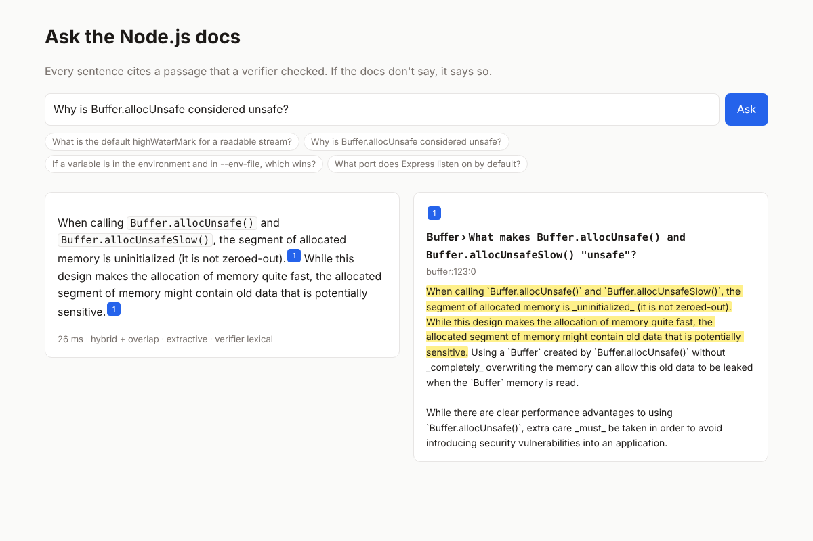

# cited-rag-evals

A learning project: I wanted to understand how retrieval-augmented generation (RAG) works under the hood, and especially how you *measure* whether it works. So I built a small question-answering system over part of the Node.js docs where every sentence of an answer cites the passage that supports it, a second pass checks each citation, and the system says "I can't find this" instead of guessing. Then I wrote a small eval suite to see which pieces actually help.

Everything runs on a normal laptop. No GPU, no API keys, no paid services. The default mode needs no downloads at all, and the "real model" mode uses small models that run on the CPU inside Node.

```
question ─► hybrid retrieval (BM25 + embeddings, RRF) ─► optional rerank ─► abstain if weak
        ─► small LLM writes {sentence, sources[]} ─► check each (sentence, source) ─► cited answer
```



The notes in [docs/concepts.md](docs/concepts.md) explain each technique and point to the file that implements it. That's the best place to start if you're learning this too.

## What I wanted to learn

- How BM25 and embedding search differ, and when fusing them (Reciprocal Rank Fusion) helps.
- Whether a cross-encoder reranker is worth its cost on a CPU.
- How to get a *small* model to produce structured, citable output, how often it cites things that don't support its claim, and how to check that cheaply (an NLI model).
- How to build a gold set and metrics (Recall@k, MRR, citation precision, abstention) that tell you something, and why confidence intervals matter on 26 questions.

## Running it

Needs Node 20+ and pnpm. Tested on a 4-core CPU with 16 GB RAM and no GPU.

```bash
pnpm install
pnpm corpus                 # download 17 Node.js v22 doc pages (~1.4 MB) into data/corpus
pnpm ingest                 # chunk and index them (~1,750 chunks)
pnpm ask "What is the default highWaterMark for a readable stream?"
pnpm eval:smoke             # score the 26-question smoke set, write evals-out/*.md and *.json
pnpm eval                   # all 108 questions
pnpm ablate                 # compare retrieval modes, reranking and verification
pnpm web                    # small local UI at http://localhost:3000
```

There are three levels, all free and local. Set the variables in your shell to move up, e.g. `EMBEDDER=local pnpm ingest` (`.env.example` lists them all):

| Level | Settings | What runs | On a 4-core CPU |
| --- | --- | --- | --- |
| Offline (default) | nothing | hashed bag-of-words "embeddings", word-overlap reranker, extractive answers, lexical citation check | instant, no downloads |
| Local embeddings | `EMBEDDER=local` `RERANKER=local` | BGE-small embeddings (~130 MB), MiniLM cross-encoder (~90 MB), via transformers.js | ingest ~4 min, then ms per query (rerank ~2 s) |
| Local LLM | `LLM_PROVIDER=local` | Qwen2.5-1.5B-Instruct, 4-bit ONNX (~1 GB), on the CPU via transformers.js, plus a DeBERTa NLI model (~70 MB) to check citations | ~1 min per question (p50 54 s); the first run also downloads the model |

If you already use [Ollama](https://ollama.com), `LLM_PROVIDER=ollama` with `GENERATOR_MODEL=qwen2.5:1.5b` (or any model you've pulled) works too and is usually faster. Re-run `pnpm ingest` after changing `EMBEDDER`; set `INDEX_PATH` if you want to keep the offline and BGE indexes side by side.

## Layout

```
packages/rag      chunking, BM25, embeddings, RRF, reranking, generation, verification, pipeline, CLIs
packages/evals    gold set, metrics, judges, bootstrap CIs, ablation runner, regression check
apps/web          small Next.js page: cited answer, clickable citations, supporting sentence highlighted
scripts/          corpus download
docs/concepts.md  my notes on each technique
```

## What I found

### Retrieval

All 108 questions, BGE-small embeddings on the CPU. Retrieval doesn't depend on the LLM, so these use the offline generator:

| Variant | Recall@5 | MRR |
| --- | --- | --- |
| dense (BGE-small) | 92.8 | 77.3 |
| bm25 | 89.2 | 77.3 |
| hybrid (RRF) | **95.8** | **81.4** |
| hybrid + word-overlap rerank | 88.0 | 73.6 |
| hybrid + MiniLM cross-encoder rerank | 88.6 | 80.5 |

- With a real embedding model, RRF does what the theory says: dense and BM25 miss *different* questions, so fusing them beats both.
- With the offline hashed "embeddings" instead, fusing hurts (hybrid 85.5 vs BM25 89.2), because the hashed retriever is just a weaker copy of BM25. RRF only helps when the second list brings new signal.
- Neither reranker helped on top of hybrid here. The cross-encoder costs about 2 s per query on a CPU and lowers Recall@5. Its one upside is a calibrated score to abstain on (refusal accuracy went from 72% to 84%).

### End to end with a small local model

The 26-question smoke set, run end to end on the CPU: BGE-small retrieval, Qwen2.5-1.5B writing the answer, a DeBERTa-v3-xsmall NLI model checking each (sentence, source) pair, and Qwen2.5-1.5B again as the correctness judge. Full report with every answer: [`results/local-smoke.md`](results/local-smoke.md).

| Metric | Local models | Offline baseline |
| --- | --- | --- |
| Recall@5 | 95.0 [85.0, 100] | 85.0 |
| Answer correctness | 50.0 [25.0, 70.0] | 40.0 |
| Citation precision, before checking | 57.9 [35.7, 84.3] | |
| Citation precision, shown answer | 100 | 100 |
| Refusal accuracy | 100 (n=6) | 66.7 |
| False refusal rate | 25.0 [10.0, 45.0] | 10.0 |
| Latency p50 / p95 | 54 s / 139 s | 9 ms / 13 ms |

Things I learned getting here:

- A 1.5B model forgets formatting. With ~2,000 tokens of sources in front of it, it ignored the "reply in JSON" instruction in the system prompt and answered in prose. Moving the JSON instruction to the *end* of the user message fixed almost all of it.
- A 1.5B model is a bad citation checker. My first run used Qwen as the verifier too, and it rejected almost every citation, including verbatim copies of the source, so 95% of answerable questions ended in a refusal. Swapping in a 70 MB NLI cross-encoder, which is built for exactly this "does A support B" question, fixed that.
- NLI models want short premises. Given a whole chunk, DeBERTa called a verbatim quote of its first sentence a contradiction. Checking one- and two-sentence windows of the source and taking the best one works (this is the SummaC idea).
- Small models often forget to cite. In my spot checks, many correct sentences came back with an empty source list. Checking those against every retrieved passage (post-hoc attribution) recovers the good ones; the "before checking" precision above still counts them as uncited.
- The checker earns its keep: only 58% of the model's own citations held up, and every shown citation passed the check.

Caveats: 20 answerable questions is tiny, so the confidence intervals are wide. The same NLI model checks citations in the pipeline and scores them in the eval, so the 100% is by construction, like offline. I compared the judge's verdicts with my own on the 15 answered questions and we agreed on 13 (it rejected one correct answer and accepted one that was just `{boolean}`).

### Offline baseline

The deterministic offline numbers on the smoke set, which a small check in CI compares against on every push so I notice when a code change makes things worse:

| Metric | Offline baseline |
| --- | --- |
| Recall@5 | 85.0% |
| Answer correctness | 40.0% |
| Refusal accuracy | 66.7% |
| False refusal rate | 10.0% |

Offline citation precision is 100% by construction: the extractive generator copies sentences verbatim, and the same lexical check acts as verifier and judge.

## Simplifications

This is a learning project, so I kept the moving parts small on purpose:

- 17 Node.js doc pages rather than all 64; `NODE_DOCS_PAGES=all pnpm corpus` fetches everything if you want to try.
- The index is one JSON file loaded into memory. At ~1,750 chunks a brute-force vector scan takes milliseconds, so there's no vector database.
- Queries are logged to a JSONL file (`data/logs/queries.jsonl`) instead of a tracing tool.
- Markdown, HTML and text only.
- The gold set (108 questions) was written by me and is small; the confidence intervals in every report are there as a reminder of that.

## Ideas to try next

- Document-side prompt injection: plant instructions inside corpus passages and see if the model follows them.
- Tune the abstention threshold on a held-out split instead of eyeballing it.
- Hand-label ~50 answers to see how often the small-model judge agrees with me.
- Try a different small model as judge (e.g. Llama 3.2 3B through Ollama) to reduce self-preference.

## License

MIT
